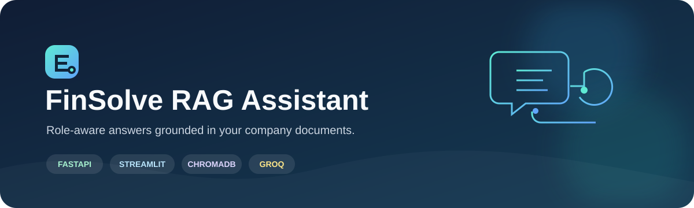
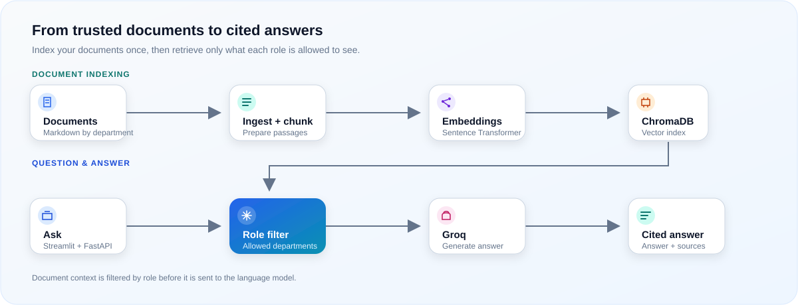

<p align="center">
  
</p>

<p align="center">
  <a href="https://github.com/vijayreddyperudi/multi-role-rag-chatbot"></a>
  
  
  
</p>

<p align="center"><b>Ask questions. Get grounded answers. See the sources.</b></p>

Ask questions about FinSolve company documents with a role-aware retrieval-augmented generation (RAG) assistant. The project combines a Streamlit chat interface, a FastAPI service, ChromaDB for vector search, sentence-transformers for embeddings, and Groq for answer generation.

> **Data note:** Company documents, generated files, the vector database, and environment files are excluded from Git. Add only documents you are authorized to use to your local `data/raw/` folder.

## Features

- Retrieves relevant answers from your local company documents.
- Restricts retrieval by the selected department role.
- Returns source document names and departments with each answer.
- Provides a FastAPI endpoint and a Streamlit user interface.
- Uses a local persistent ChromaDB collection for document embeddings.

## How it works

<p align="center">
  
</p>

## Requirements

- Python and `pip`
- A Groq API key
- Local Markdown documents to index

## Getting started

### 1. Clone the repository

```bash
git clone https://github.com/vijayreddyperudi/multi-role-rag-chatbot.git
cd multi-role-rag-chatbot
```

### 2. Create and activate a virtual environment

**Windows PowerShell**

```powershell
python -m venv .venv
.\.venv\Scripts\Activate.ps1
```

**macOS / Linux**

```bash
python -m venv .venv
source .venv/bin/activate
```

### 3. Install dependencies

```bash
python -m pip install fastapi "uvicorn[standard]" pydantic streamlit requests chromadb sentence-transformers python-dotenv groq
```

The first embedding run downloads the `sentence-transformers/all-MiniLM-L6-v2` model.

### 4. Configure Groq

Create a `.env` file in the project root and add your key:

```dotenv
GROQ_API_KEY=your_groq_api_key
```

Keep `.env` private. Do not commit API keys or other secrets.

### 5. Add your documents

Place authorized Markdown (`.md`) documents under `data/raw/DS-RPC-01/data/`, organized by department. The department is read from the containing folder name.

```text
data/
└── raw/
    └── DS-RPC-01/
        └── data/
            ├── engineering/
            │   └── engineering_guide.md
            ├── finance/
            │   └── finance_overview.md
            ├── general/
            │   └── employee_handbook.md
            ├── hr/
            └── marketing/
```

The checked-out repository does not include the source documents or a prebuilt vector database. You must supply documents and build the database locally.

### 6. Build the vector database

Run these commands from the project root, in order:

```bash
python scripts/ingest_documents.py
python scripts/chunk_documents.py
python scripts/create_embeddings.py
python scripts/build_vector_db.py
```

This creates intermediate files under `data/processed/` and the persistent ChromaDB collection under `data/chroma_db/`. Those generated files are local and ignored by Git.

### 7. Start the API and interface

Open two terminals in the project root and activate the virtual environment in both.

**Terminal 1 — API**

```bash
python -m uvicorn app.main:app --reload
```

The API is available at `http://127.0.0.1:8000`. Check its health at `http://127.0.0.1:8000/health`; interactive API documentation is at `http://127.0.0.1:8000/docs`.

**Terminal 2 — Streamlit**

```bash
python -m streamlit run streamlit_app.py
```

Use the URL printed by Streamlit, select a role, and ask a question.

## API

`POST /ask` accepts a question and a role header:

```http
POST /ask
Content-Type: application/json
X-User-Role: finance

{
  "question": "What does the finance documentation say?"
}
```

Roles currently accepted by the API are `employee`, `engineering`, `finance`, `hr`, `marketing`, and `executive`. Questions must contain 1–2,000 characters.

Example response:

```json
{
  "answer": "Answer based on the documents available to this role.",
  "sources": [
    {
      "source": "finance_overview.md",
      "department": "finance"
    }
  ]
}
```

`GET /health` returns `{"status": "ok"}`.

## Access control and security

Department access is defined in [`app/auth/access_control.py`](app/auth/access_control.py). The Streamlit interface sends the selected role through `X-User-Role`; this is **development-time role selection, not authentication**. Do not expose this service as a secure multi-user system without adding trusted identity verification and enforcing roles on the server.

Never commit `.env`, private source documents, processed datasets, embeddings, or the ChromaDB directory. Review staged changes before pushing.

## Project layout

```text
app/
  api/                 FastAPI routes and request validation
  auth/                Department-to-role access rules
  services/            Retrieval and Groq answer generation
scripts/               Document ingestion, embedding, indexing, and checks
streamlit_app.py       Streamlit user interface
data/raw/              Local source documents (not committed)
data/processed/        Local intermediate files (not committed)
data/chroma_db/        Local vector database (not committed)
```

## License

No license is currently specified. Contact the repository owner before redistributing or reusing this project.
